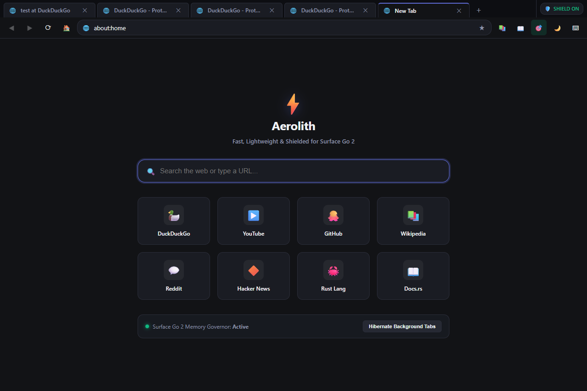

# Aerolith Agent (`aerolith-agent`)

An ultra-lightweight, hardware-optimized web browser written in Rust, engineered from the ground up for **AI agents, multimodal LLMs, and autonomous web automation**.

Forked from the high-performance [`aerolith-browser`](https://github.com/nri99/aerolith-browser) architecture, **Aerolith Agent** pairs kernel-level tab memory hibernation (~0 MB RAM per inactive tab) and anti-bot stealth with a first-class **AI Agent Control Plane**.

---

## Why Aerolith Agent?

| Feature | Standard Chromium / Playwright | Aerolith Agent |
| :--- | :--- | :--- |
| **Agent Protocol** | Requires Node.js, heavy CDP drivers, Python libraries | **Native MCP stdio Server + Embedded HTTP REST Server** |
| **Token Consumption** | Dumps 30k–80k tokens of raw HTML per page | **Semantic Accessibility Tree (~500–1,500 tokens, 95% savings)** |
| **Vision Grounding** | Coordinate guessing / blind vision clicks | **Built-in Set-Of-Marks (SOM) visual bounding tags** |
| **Content Reading** | Complex DOM scrapers required | **1-call clean Markdown extraction (strips ads/navbars/cookies)** |
| **RAM Footprint** | 800 MB – 2.5 GB+ across multiple tabs | **Two-Tier Memory Governor (~0 MB per hibernated tab)** |
| **Anti-Bot Detection** | Headless flags, `navigator.webdriver` leaks | **Undetectable stealth, canvas farbling, WebRTC LAN protection** |
| **CLI Control** | Complex wrapper scripts | **Single binary CLI subcommands (`nav`, `click`, `type`, `snapshot`)** |

---

## Visual Showcase

### Offline Speed Dial & Instant Search
*Custom offline `about:home` dashboard with high-DPI scaling, prioritized bookmark shortcuts, and live memory governor status.*


### Privacy Shield & Settings Drawer
*Slide-over settings drawer featuring live hardware memory telemetry and real-time multi-layer anti-fingerprinting status.*


### Desktop Tab Management & Zoom Controls
*Full right-click context menu (Duplicate, Reload, Mute, Close Others, Reopen) and dynamic in-omnibox hardware zoom level badges.*


---

## Core AI Agent Capabilities

### 1. Native Model Context Protocol (MCP) Server
Aerolith Agent implements the official JSON-RPC 2.0 **Model Context Protocol** over stdio. Connect any modern AI agent (Claude Desktop, Antigravity, Cursor, Gemini CLI) with a single configuration entry:

```json
{
  "mcpServers": {
    "aerolith": {
      "command": "C:\\path\\to\\aerolith-agent.exe",
      "args": ["mcp"]
    }
  }
}
```

#### Available MCP Tools
- `browser_navigate`: Navigate active tab to any URL (`{"url": "https://example.com"}`).
- `browser_back`: Navigate active tab back in browser history.
- `browser_forward`: Navigate active tab forward in browser history.
- `browser_reload`: Reload the active page.
- `browser_get_text`: Extract inner text, input value, or specific HTML attribute of an element (`{"target": "3", "attribute": "href"}`).
- `browser_snapshot`: Get a compact semantic accessibility tree with numbered target IDs (`@1`, `@2`, ...), optional `viewport_only: true`, and role filter (`filter_role: "button"`).
- `browser_highlight`: Visually highlight element with an animated focus ring to confirm visual grounding (`{"target": "3"}`).
- `browser_hover`: Hover mouse over an element to reveal tooltips, flyout menus, and trigger CSS `:hover` states (`{"target": "3"}`).
- `browser_click`: Click an interactive element by reference ID (`{"target": "3"}`) or CSS selector, returning DOM mutation diffs (`url_changed`, `mutations_observed`).
- `browser_type`: Type text into an input field (`{"target": "2", "text": "Rust lang", "submit": true}`).
- `browser_press_key`: Press keyboard key like Escape, Enter, Tab, ArrowDown, Backspace (`{"key": "Escape", "target": "#modal"}`).
- `browser_select_option`: Pick option in select dropdown by value, label, or index (`{"target": "select#country", "value": "US"}`).
- `browser_drag`: Drag an element to a target element or coordinate offset, supporting HTML5 drag-and-drop and range sliders (`{"source": "1", "offset_x": 100, "steps": 10}`).
- `browser_cookies`: Get, set, delete, or clear cookies via CDP (`{"action": "set", "cookie": {"name": "sid", "value": "xyz"}}`).
- `browser_set_headers`: Set persistent custom HTTP request headers via CDP (`{"headers": {"X-Custom": "1"}}`).
- `browser_set_user_agent`: Override browser User-Agent, Accept-Language, and Platform via CDP (`{"user_agent": "CustomBot/1.0"}`).
- `browser_upload_file`: Upload files to `<input type="file">` elements (`{"target": "1", "files": ["resume.pdf"]}`).
- `browser_set_location`: Emulate geographical coordinates and timezone (`{"latitude": 40.7128, "longitude": -74.0060, "timezone": "America/New_York"}`).
- `browser_media_control`: Inspect and control audio/video playback (`{"action": "pause"}`).
- `browser_inspect_element`: Deeply inspect tag name, text, value, computed styles, viewport visibility, and bounding rect (`{"target": "3"}`).
- `browser_route_rule`: Dynamically intercept, abort, or mock network requests matching specific URL patterns (`{"action": "abort", "pattern": "*.png"}`).
- `browser_double_click`: Simulate a human-like double click with sticky-header occlusion compensation (`{"target": "3"}`).
- `browser_right_click`: Simulate a right-click / context menu event on an element (`{"target": "3"}`).
- `browser_extract_table`: Extract structured data rows and headers from an HTML table into clean JSON records (`{"target": "table"}`).
- `browser_get_downloads`: Retrieve recorded browser file downloads or clear history (`{"clear": false}`).
- `browser_emulate_network`: Throttle or emulate network connectivity (online, offline, slow-3g, fast-3g) via CDP (`{"profile": "slow-3g"}`).
- `browser_inject_css`: Inject custom CSS rules to eliminate floating headers, banners, or occluding elements (`{"css": "header { display: none !important; }"}`).
- `browser_query_elements`: Batch query and inspect multiple DOM elements matching a CSS selector (`{"selector": "a.result", "attribute": "href"}`).
- `browser_focus`: Explicitly focus an element to trigger framework validation and input readiness (`{"target": "input#email"}`).
- `browser_blur`: Explicitly blur an element to trigger framework change events (`{"target": "input#email"}`).
- `browser_get_page_info`: Retrieve page layout metrics, scroll progress, document dimensions, and window metadata.
- `browser_get_html`: Extract raw HTML source for the entire document or a specific DOM element (`{"target": "#app"}`).
- `browser_scroll_into_view`: Scroll a specific element into view with block alignment and automatic sticky-header occlusion compensation (`{"target": "#checkout", "align": "center"}`).
- `browser_set_zoom`: Set browser rendering zoom factor with dual-layer CSS and CDP scaling (`{"zoom_factor": 1.25}`).
- `browser_storage_item`: Inspect or mutate granular localStorage or sessionStorage keys (`{"action": "set", "storage_type": "local", "key": "theme", "value": "dark"}`).
- `browser_assert_element`: Verify element state against declarative assertions (visible, hidden, disabled, checked, text, value, classes, attributes) (`{"target": "#save", "visible": true, "disabled": false}`).
- `browser_wait_for_selector`: Wait for a DOM element to reach a target state: 'visible', 'hidden', 'attached', or 'detached' (`{"target": ".spinner", "state": "hidden", "timeout_ms": 5000}`).
- `browser_get_performance_metrics`: Retrieve page performance metrics (TTFB, DOMContentLoaded, load time, resource breakdown, transfer bytes, JS heap memory).
- `browser_scroll_to_coords`: Scroll the viewport directly to specific absolute (x, y) coordinates (`{"x": 0, "y": 1200, "smooth": true}`).
- `browser_get_page_outline`: Retrieve compact semantic outline of the page: headings hierarchy, form structures, landmarks, interactive buttons, and links (`{"max_links": 25, "max_buttons": 25}`).
- `browser_wait_for_network_idle`: Wait until active network requests remain at or below max_inflight for consecutive idle_time_ms (`{"idle_time_ms": 500, "timeout_ms": 10000, "max_inflight": 0}`).
- `browser_watch_mutations`: Control and query DOM mutation records (start, stop, clear, get) (`{"action": "get"}`).
- `browser_tab_eval`: Evaluate a JavaScript expression directly in a specific tab by index without switching active GUI focus (`{"tab_index": 1, "script": "document.title"}`).
- `browser_get_response_body`: Search recorded network activity for requests matching a URL pattern and return the captured response body (`{"pattern": "/api/users"}`).
- `browser_drop_file`: Dispatch a synthetic file drag-and-drop or file input upload with custom file metadata and content (`{"target": "#dropzone", "file_name": "data.csv", "content": "col1,col2"}`).
- `browser_get_dom_tree`: Serialize a nested hierarchical JSON tree of visible DOM nodes starting from root or target selector (`{"max_depth": 3}`).
- `browser_set_offline`: Instantly simulate network offline or online state via CDP Network emulation (`{"offline": true}`).
- `browser_wait_for_text`: Wait until specific text substring appears in the document or a specified target element (`{"text": "Payment successful", "timeout_ms": 5000}`).
- `browser_get_computed_styles`: Read computed CSS style properties (e.g. display, visibility, opacity, color, z-index) for an element (`{"target": "#menu", "properties": ["display", "visibility", "z-index"]}`).
- `browser_wait_for_download`: Wait for a new file download initiated by the page to appear, optionally matching a filename pattern (`{"file_pattern": "report", "timeout_ms": 15000}`).
- `browser_set_content`: Set the HTML content of the active page directly via document.write, replacing the current document (`{"html": "<h1>Test Page</h1>"}`).
- `browser_get_forms`: Inspect and structure all HTML forms and their controls (input, select, textarea, button) on the active page (`{"target": "#login-modal"}`).
- `browser_set_visibility`: Force-emulate document.visibilityState ('visible' or 'hidden') and trigger visibilitychange event (`{"state": "visible"}`).
- `browser_emulate_media`: Emulate media color scheme ('dark', 'light', 'no-preference') and/or media type ('screen', 'print') via CDP (`{"color_scheme": "dark"}`).
- `browser_get_element_bounds`: Extract exact pixel bounding box coordinates (x, y, width, height, center_x, center_y) and visibility metrics for an element (`{"target": "#hero"}`).
- `browser_mock_route`: Mock network responses for fetch/XHR requests matching a URL pattern (`{"pattern": "/api/users", "status": 200, "body": "[{\"id\":1}]"}`).
- `browser_get_viewport`: Retrieve active viewport dimensions, scroll offsets, screen metrics, and device pixel ratio.
- `browser_set_element_attribute`: Dynamically set or remove an HTML attribute on a DOM element for self-healing automation (`{"target": "#btn", "attribute": "disabled"}`).
- `browser_fill_form`: Atomically populate multiple input fields in a single turn (`{"fields": [{"target": "1", "value": "alice"}], "submit": true}`).
- `browser_get_network_activity`: Retrieve recorded AJAX/fetch requests and in-flight count (`{"clear": false}`).
- `browser_get_markdown`: Extract clean, readable article markdown, stripping navbars, footers, and cookie banners.
- `browser_screenshot`: Capture visual screenshot with optional Set-Of-Marks tags (`{"som": true}`) and full scrollable height (`{"full_page": true}`).
- `browser_screenshot_element`: Capture cropped screenshot of an exact element bounding box with optional padding for high-DPI vision inspection (`{"target": "3", "padding": 8}`).
- `browser_clipboard`: Read or write the browser clipboard (`{"action": "write", "text": "token"}`).
- `browser_scroll`: Scroll viewport (`{"direction": "down", "amount": 500}`).
- `browser_eval`: Execute arbitrary JavaScript expression in the active tab context.
- `browser_wait_for`: Wait for element presence and network idle (`{"target": "#results", "timeout_ms": 5000}`).
- `browser_find_element`: Fuzzy search interactive elements by text, placeholder, or role (`{"query": "Submit"}`).
- `browser_dialog_policy`: Configure automated responses for `alert()`, `confirm()`, and `prompt()` modals.
- `browser_storage_state`: Export or restore cookies, `localStorage`, and `sessionStorage`.
- `browser_manage_tabs`: List open tabs, open a new tab, switch tabs, or close tabs.
- `browser_set_viewport`: Emulate device viewport width, height, device pixel ratio, and mobile emulation (`{"width": 375, "height": 812, "dpr": 3.0, "mobile": true}`).
- `browser_get_console_logs`: Retrieve buffered browser console logs and unhandled runtime errors (`{"clear": false}`).
- `browser_print_pdf`: Generate high-fidelity vector PDF from active page via CDP (`{"landscape": false}`).
- `browser_playwright_info`: Query Playwright connection strings, Python/Node snippets, and active CDP endpoints.
- `browser_cdp_info`: Query CDP WebSocket and Playwright/Puppeteer connection details.
- `browser_cdp_execute`: Run raw CDP JSON-RPC methods (`{"method": "Page.captureScreenshot"}`).

---

### 2. Semantic DOM & Accessibility Tree (`/snapshot`)
Instead of overwhelming LLM context windows with 50,000+ tokens of raw HTML, scripts, and styling, Aerolith Agent parses the visible DOM into an indexed semantic representation:

```text
=== SEMANTIC ACCESSIBILITY SNAPSHOT ===
URL: https://github.com/login
Title: Sign in to GitHub · GitHub
---------------------------------------
[1] <a "Skip to content" href="#start-of-content" bounds=0,0,0,0>
[2] <a "GitHub" href="https://github.com/" bounds=620,32,32,32>
<h1> Sign in to GitHub
[3] <input text "Username or email address" placeholder="" value="" bounds=490,180,300,34>
[4] <input password "Password" placeholder="" value="" bounds=490,248,300,34>
[5] <a "Forgot password?" href="/password_reset" bounds=712,228,88,16>
[6] <button "Sign in" bounds=490,302,300,34>
[7] <a "Create an account" href="/signup" bounds=630,420,110,18>
```

Every interactive element is assigned a stable `@ref` number that maps directly to action commands:
```bash
aerolith-agent type 3 "my-username"
aerolith-agent type 4 "my-password"
aerolith-agent click 6
```

---

### 3. Set-Of-Marks (SOM) Visual Grounding & Focus Highlighter (`highlight`)
For multimodal vision models (Claude 3.5 Sonnet, GPT-4o, Gemini 2.0 / 1.5 Pro), coordinate hallucination is a primary source of failure.

Aerolith Agent features native **Set-Of-Marks (SOM)** overlays and visual element confirmation:
- **Set-Of-Marks Overlays**: Running `screenshot --som` or `GET /screenshot?som=1` automatically renders high-contrast numeric bounding badges (`#1`, `#2`, `#3`) over every interactive element on the page before capture.
- **Visual Focus Highlighter**: Running `highlight <ref>` or `POST /highlight {"target": "4"}` draws an animated focus ring around the target element to verify visual grounding before initiating clicks or form entry.
- **Full-Page CDP Screenshots**: Running `screenshot --full-page` or `GET /screenshot?full=1` captures the full scrollable page height via native Chrome DevTools Protocol emulation.

---

### 4. Clean Markdown Extraction (`/markdown`)
Agents frequently need to summarize or extract data from articles, documentation, or search results.

Aerolith Agent converts web content directly to clean GitHub-flavored Markdown:
- Automatically targets `<main>`, `<article>`, or core content containers.
- Formats headers, code blocks, lists, blockquotes, and tables.
- Strips cookie consent banners, advertisement overlays, navigation menus, and script artifacts.

---

### 5. Playwright Integration & Native CDP Bridge
Aerolith Agent includes a bi-directional **Chrome DevTools Protocol (CDP)** bridge on port `9222` (configurable via `--cdp-port <port>` or `--no-cdp` to disable) and first-class Playwright SDKs for **Python** and **Node.js**.

#### First-Class Playwright SDKs (`integrations/`)
Aerolith Agent comes with native drop-in SDK wrappers that enrich standard Playwright `Page` objects with Aerolith superpowers:

```python
# Python: integrations/playwright-python/aerolith_playwright.py
from playwright.sync_api import sync_playwright
from aerolith_playwright import connect_aerolith

with sync_playwright() as p:
    browser, page = connect_aerolith(p, cdp_url="http://127.0.0.1:9222")
    page.goto("https://duckduckgo.com")

    # Aerolith extensions on the standard Playwright page:
    snapshot = page.semantic_snapshot(viewport_only=True)  # Token-efficient DOM
    page.highlight("input[name=q]")                       # Animated focus ring
    page.fill_form([{"target": "input[name=q]", "value": "Rust"}], submit=True)
    page.screenshot_element("input[name=q]", path="crop.png") # High-DPI crop
    page.screenshot_som("som.png")                        # Set-Of-Marks overlay
```

```javascript
// Node.js: integrations/playwright-node/index.js
const playwright = require('playwright');
const { connectAerolith } = require('./integrations/playwright-node');

(async () => {
  const { browser, page } = await connectAerolith(playwright);
  await page.goto('https://duckduckgo.com');

  const snapshot = await page.semanticSnapshot({ viewportOnly: true });
  await page.highlight('input[name=q]');
  await page.fillForm([{ target: 'input[name=q]', value: 'Rust' }], { submit: true });
  await page.screenshotSom({ path: 'som.png' });
  await browser.close();
})();
```

#### Playwright CLI Diagnostics (`aerolith-agent playwright`)
Inspect CDP endpoints, verify connectivity, or print quickstart boilerplate:
```bash
# Verify live CDP connection and test WebSocket handshake
aerolith-agent playwright --test

# Output ready-to-run Python Playwright script
aerolith-agent playwright --python

# Output ready-to-run Node.js Playwright script
aerolith-agent playwright --node

# Query CDP metadata
aerolith-agent cdp
```

#### Direct CDP Method Execution over HTTP (`POST /cdp/execute`)
Execute raw Chrome DevTools Protocol commands without needing a WebSocket library:
```bash
# Evaluate JavaScript via CDP
curl -X POST http://127.0.0.1:8765/cdp/execute -d '{"method":"Runtime.evaluate","params":{"expression":"window.location.href"}}'

# Or via CLI
aerolith-agent cdp-eval Runtime.evaluate '{"expression":"document.title"}'
aerolith-agent cdp-eval Page.captureScreenshot
```

---

### 6. Smart Element Locator (`/find`)
Skip scanning the full accessibility tree when you already know what you're looking for:

```bash
# Find interactive elements by text, placeholder, aria-label, role, or value
aerolith-agent find "Sign in"
aerolith-agent find "Password"

# Or via REST:
curl "http://127.0.0.1:8765/find?q=Submit"
```
Returns instant matching element refs (`[@4] <button> "Submit" center=450,280 in_viewport=true`) ready for 1-click execution.

---

### 7. Dialog Auto-Interception & Policy (`/dialog`)
Prevent script stalls and browser thread freezing caused by unexpected `window.alert`, `window.confirm`, or `window.prompt` dialogs:

```bash
# Set automated response policy
aerolith-agent dialog --confirm accept --prompt "approved"

# Query recorded dialog history
aerolith-agent dialog
```

---

### 8. Storage State Import & Export (Cookies, localStorage, sessionStorage)
For reproducible agent evals and authenticated workflows, Aerolith Agent supports 1-call full state serialization and restoration:

```bash
# Export active cookies, localStorage, and sessionStorage
aerolith-agent storage --export --out session_state.json

# Restore state into a fresh session
aerolith-agent storage --import session_state.json
```

Or via REST:
```bash
# Export
curl http://127.0.0.1:8765/storage/state

# Import
curl -X POST http://127.0.0.1:8765/storage/state -d @session_state.json
```

---

### 9. Embedded HTTP REST Daemon
Aerolith Agent runs a zero-overhead local HTTP server on port `8765` (configurable via `--port`):

```bash
# Health check & capabilities
curl http://127.0.0.1:8765/health

# Navigate to URL
curl -X POST http://127.0.0.1:8765/navigate -d '{"url":"https://news.ycombinator.com"}'

# Smart wait for element or network idle (0 in-flight requests)
curl -X POST http://127.0.0.1:8765/wait -d '{"target":"button#login","timeout_ms":5000}'

# Extract clean markdown
curl http://127.0.0.1:8765/markdown

# Get compact accessibility tree (add ?viewport_only=1 to save 80% tokens on long pages)
curl http://127.0.0.1:8765/snapshot?viewport_only=1

# Click an element by reference ID (with automatic retry)
curl -X POST http://127.0.0.1:8765/click -d '{"target":"2"}'

# Hover mouse over an element to reveal submenus or tooltips
curl -X POST http://127.0.0.1:8765/hover -d '{"target":"#menu"}'

# Dispatch keyboard event (e.g. Escape to dismiss modals)
curl -X POST http://127.0.0.1:8765/key -d '{"key":"Escape"}'

# Select option in dropdown
curl -X POST http://127.0.0.1:8765/select -d '{"target":"select#country","value":"US"}'

# Drag element or slide range slider
curl -X POST http://127.0.0.1:8765/drag -d '{"source":"#slider","offset_x":150,"steps":10}'

# Query all browser cookies via CDP
curl http://127.0.0.1:8765/cookies

# Set custom HTTP request headers
curl -X POST http://127.0.0.1:8765/headers -d '{"X-Agent-ID":"aerolith-01"}'

# Override browser User-Agent
curl -X POST http://127.0.0.1:8765/user_agent -d '{"user_agent":"AerolithAgent/1.0"}'

# Upload files to file input
curl -X POST http://127.0.0.1:8765/upload -d '{"target":"input[type=file]","files":["avatar.png"]}'

# Emulate geolocation and timezone
curl -X POST http://127.0.0.1:8765/location -d '{"latitude":51.5074,"longitude":-0.1278,"timezone":"Europe/London"}'

# Mute or pause all playing media elements
curl -X POST http://127.0.0.1:8765/media -d '{"action":"pause"}'

# Inspect recent AJAX/fetch network activity
curl http://127.0.0.1:8765/network

# Emulate mobile screen dimensions and DPR
curl -X POST http://127.0.0.1:8765/emulate -d '{"width":390,"height":844,"dpr":3.0,"mobile":true}'

# Retrieve browser console errors and logs
curl http://127.0.0.1:8765/console

# Generate vector PDF
curl http://127.0.0.1:8765/pdf -o document.pdf
```

---

### 10. Multi-Profile & Ephemeral Sandboxing
Run multiple isolated agent sessions with independent storage, cookies, and cache partitions:

```bash
# Persistent named profile
aerolith-agent --profile research_agent_1

# Isolated in-memory ephemeral session (auto-cleaned on exit)
aerolith-agent --ephemeral

# Profile management
aerolith-agent profile
aerolith-agent profile --clear research_agent_1
```

---

### 11. Zero-Dependency Terminal CLI
Any shell script, Python script, or terminal agent can drive the browser instantly:

```bash
# Launch browser in background agent mode
aerolith-agent serve --port 8765 --cdp-port 9222

# Command line actions
aerolith-agent nav "https://duckduckgo.com"
aerolith-agent back
aerolith-agent forward
aerolith-agent reload
aerolith-agent text 1
aerolith-agent snapshot -v
aerolith-agent snapshot -r button
aerolith-agent highlight 1
aerolith-agent find "Search"
aerolith-agent wait "input[name=q]"
aerolith-agent type 1 "Rust programming" --enter
aerolith-agent fill '[{"target":"1","value":"query"}]' --submit
aerolith-agent hover 2
aerolith-agent click 3
aerolith-agent key Escape
aerolith-agent select 4 "US"
aerolith-agent drag 5 --dx 100 --steps 10
aerolith-agent cookies
aerolith-agent headers '{"X-Bot":"Aerolith"}'
aerolith-agent user-agent "Mozilla/5.0 AerolithAgent" --lang "en-US"
aerolith-agent upload 5 document.pdf
aerolith-agent location 40.7128 -74.0060 --timezone "America/New_York"
aerolith-agent media --pause
aerolith-agent inspect 1
aerolith-agent route --block "*.png"
aerolith-agent route --mock "*/api/user" --body '{"name":"Alice"}'
aerolith-agent network
aerolith-agent emulate 390 844 --dpr 3.0 --mobile
aerolith-agent console
aerolith-agent pdf page.pdf --landscape
aerolith-agent clipboard --set "aerolith"
aerolith-agent clipboard
aerolith-agent markdown
aerolith-agent screenshot page.png --som --full-page
aerolith-agent screenshot-element 1 element.png
aerolith-agent storage --export --out state.json
aerolith-agent playwright --test
aerolith-agent cdp
aerolith-agent dblclick 3
aerolith-agent right-click 4
aerolith-agent table "table.prices"
aerolith-agent downloads
aerolith-agent throttle --profile slow-3g
aerolith-agent css "header { display: none !important; }"
aerolith-agent query "a.result" --attr href --limit 10
aerolith-agent focus "input#search"
aerolith-agent blur "input#search"
aerolith-agent info
aerolith-agent html "#content"
aerolith-agent scroll-into-view "#pricing" --align start
aerolith-agent zoom 1.25
aerolith-agent storage-item set --key theme --val dark
aerolith-agent assert-element "#submit-btn" --visible --disabled --text "Submit"
aerolith-agent wait-selector ".spinner" --state hidden --timeout 5000
aerolith-agent perf
aerolith-agent scroll-to 0 1200 --smooth
aerolith-agent outline --links 20 --buttons 15
aerolith-agent wait-idle --idle 500 --timeout 8000
aerolith-agent mutations get
aerolith-agent tab-eval 1 "document.title"
aerolith-agent response-body "/api/search"
aerolith-agent drop-file "#dropzone" "report.csv"
aerolith-agent dom-tree "#app" --depth 3
aerolith-agent offline true
aerolith-agent wait-text "Order Confirmed" --timeout 5000
aerolith-agent computed-styles "#hero" display visibility opacity z-index
aerolith-agent wait-download "invoice" --timeout 10000
aerolith-agent set-content "<h1>Autonomous Test</h1>"
aerolith-agent forms
aerolith-agent visibility visible
aerolith-agent emulate-media --scheme dark
aerolith-agent bounds "#hero"
aerolith-agent mock-route "/api/users" "[{\"id\":1}]" --status 200
aerolith-agent viewport
aerolith-agent attr-set "#submit" disabled --remove
aerolith-agent search-text "Order Total" --max 5
aerolith-agent storage-dump --type all
aerolith-agent human-jitter --duration 1000
aerolith-agent type-keystrokes "#search" "flights" --delay 30 --enter
aerolith-agent canvas-data "#chart" --format png --out chart.png
aerolith-agent resource-timing --initiator script --max 20
aerolith-agent dom-stats
aerolith-agent scroll-by 0 350 --smooth
aerolith-agent scroll-container "#feed" 0 500 --smooth
aerolith-agent select-text "#editor" --start 0 --length 50
aerolith-agent links --max 50 --external
aerolith-agent element-state "#submit"
aerolith-agent class-toggle "#modal" hidden toggle
aerolith-agent set-text "#heading" "New Title"
aerolith-agent dispatch-event "#cart" "cart:refresh" --detail '{"id":123}'
aerolith-agent active-element
aerolith-agent clickable "#submit-button"
aerolith-agent wheel "#map" --dx 0 --dy -120 --ctrl
aerolith-agent css-vars "#theme-root" --names "--primary-color" "--font-size"
aerolith-agent clear-highlights
aerolith-agent pointer-click "#canvas-widget" --count 2
aerolith-agent meta-tags
aerolith-agent geometry
aerolith-agent orientation 90.0 45.0 -15.0 --absolute
aerolith-agent clear-cache --storage --cookies
aerolith-agent element-spacing "#hero-banner"
aerolith-agent wait-url "/dashboard" --timeout 5000
aerolith-agent touch "#swipe-card" 150 300 --type touchstart
aerolith-agent tabs
aerolith-agent tabs new "https://example.com"
aerolith-agent tabs switch 1
aerolith-agent tabs close 1
```

---

### 12. Anti-Bot Stealth by Default
Built on Aerolith's anti-surveillance engine:
- **`navigator.webdriver = false`**: Defeats generic bot detection flags.
- **Canvas Bit Farbling**: Flips least significant bits (LSB) on canvas pixel operations to neutralize canvas fingerprinting without visual distortion.
- **AudioContext Oscillator Noise**: Injects micro-entropy variations into audio buffer frequencies.
- **Hardware & Battery Entropy Normalization**: Generic `navigator.getBattery()`, `hardwareConcurrency = 4`, `deviceMemory = 8`.
- **WebRTC Local Host IP Protection**: Drops private RFC 1918 subnet ICE candidates (`192.168.*`, `10.*`, `172.16–31.*`).
- **Global Privacy Signals**: Broadcasts `GPC = true` and `DNT = "1"`.
- **85+ Ad & Telemetry Network Blocker**: Native Rust request filtering drops tracking hosts before socket creation.

---

### 13. Two-Tier Tab Memory Governor
Unlike Chromium which consumes 100–300 MB per tab:
- **Tier 1 (2 min inactive):** Throttles `requestAnimationFrame` loops to 1 FPS and limits timers.
- **Tier 2 (10 min inactive or low RAM):** Entirely drops the underlying WebView instance to reclaim physical memory (**~0 MB RAM footprint per hibernated tab**) while preserving scroll position and navigation state.
- **Smart Sleep Exemptions:** Background audio playback (`HTMLMediaElement.play`) and dirty form inputs are strictly exempt from hibernation.

---

## Building and Testing

### Prerequisites
- **Rust 1.85+** (`cargo`, `rustc`)
- **Windows:** Windows 10/11 with WebView2 Runtime
- **macOS:** macOS 11.0+ (WebKit built-in)
- **Linux:** WebKitGTK 4.0/4.1 (`libwebkit2gtk-4.1-dev` or `libwebkit2gtk-4.0-dev`)

### Running Automated Tests
```bash
cargo test
```
*Executes the complete 78-test automated unit test suite verifying agent commands, MCP wire protocols, CDP bridges, storage state exports, semantic DOM generation, base64 decoders, memory telemetry, and anti-fingerprinting injections.*

### Compiling Release Binary
```bash
cargo build --release
```
Produces the optimized binary at `target/release/aerolith-agent.exe`.

---

## License
Licensed under either of [Apache License, Version 2.0](LICENSE-APACHE) or [MIT License](LICENSE-MIT) at your option.
