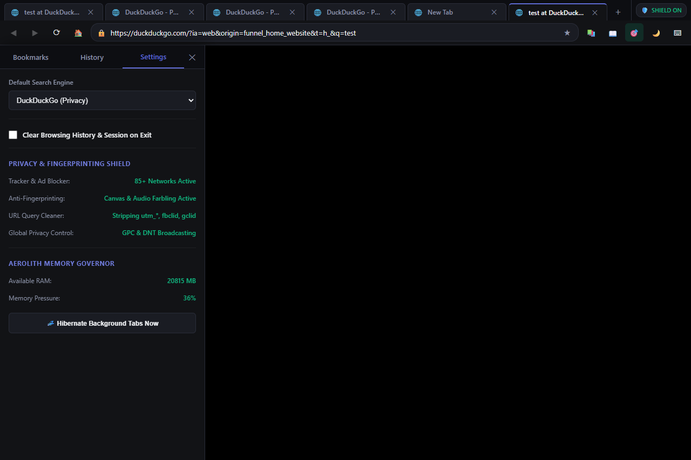
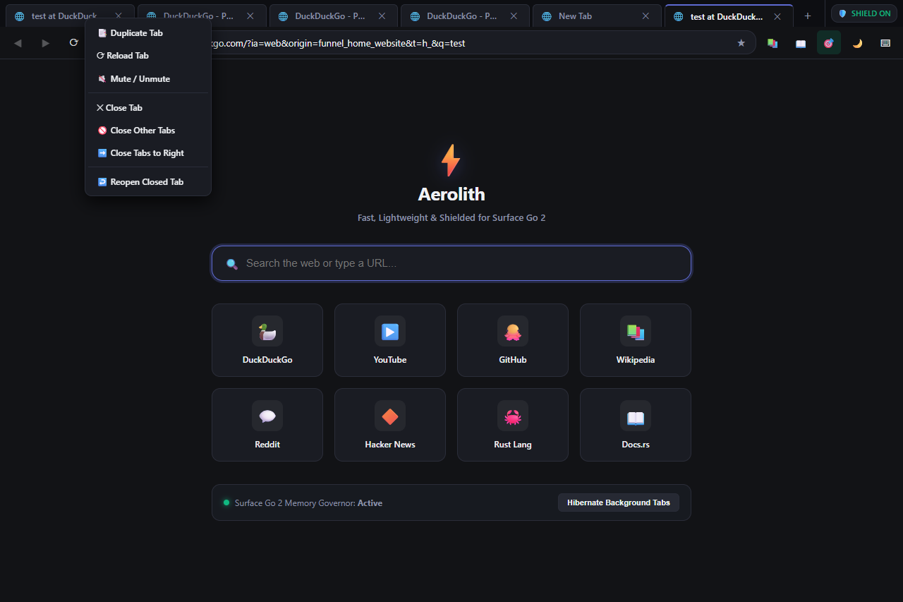

# Aerolith Agent (`aerolith-agent`)

An ultra-lightweight, hardware-optimized web browser written in Rust, engineered from the ground up for **AI agents, multimodal LLMs, and autonomous web automation**.

Forked from the high-performance [`aerolith-browser`](https://github.com/nri99/aerolith-browser) architecture, **Aerolith Agent** pairs kernel-level tab memory hibernation (~0 MB RAM per inactive tab) and anti-bot stealth with a first-class **AI Agent Control Plane**.

---

## Why Aerolith Agent?

| Feature | Standard Chromium / Playwright | Aerolith Agent |
| :--- | :--- | :--- |
| **Agent Protocol** | Requires Node.js, heavy CDP drivers, Python libraries | **Native MCP stdio Server + Embedded HTTP REST Server** |
| **Token Consumption** | Dumps 30k–80k tokens of raw HTML per page | **Semantic Accessibility Tree (~500–1,500 tokens, 95% savings)** |
| **Vision Grounding** | Coordinate guessing / blind vision clicks | **Built-in Set-Of-Marks (SOM) visual bounding tags** |
| **Content Reading** | Complex DOM scrapers required | **1-call clean Markdown extraction (strips ads/navbars/cookies)** |
| **RAM Footprint** | 800 MB – 2.5 GB+ across multiple tabs | **Two-Tier Memory Governor (~0 MB per hibernated tab)** |
| **Anti-Bot Detection** | Headless flags, `navigator.webdriver` leaks | **Undetectable stealth, canvas farbling, WebRTC LAN protection** |
| **CLI Control** | Complex wrapper scripts | **Single binary CLI subcommands (`nav`, `click`, `type`, `snapshot`)** |

---

## Visual Showcase

### Offline Speed Dial & Instant Search
*Custom offline `about:home` dashboard with high-DPI scaling, prioritized bookmark shortcuts, and live memory governor status.*


### Privacy Shield & Settings Drawer
*Slide-over settings drawer featuring live hardware memory telemetry and real-time multi-layer anti-fingerprinting status.*


### Desktop Tab Management & Zoom Controls
*Full right-click context menu (Duplicate, Reload, Mute, Close Others, Reopen) and dynamic in-omnibox hardware zoom level badges.*


---

## Core AI Agent Capabilities

### 1. Native Model Context Protocol (MCP) Server
Aerolith Agent implements the official JSON-RPC 2.0 **Model Context Protocol** over stdio. Connect any modern AI agent (Claude Desktop, Antigravity, Cursor, Gemini CLI) with a single configuration entry:

```json
{
  "mcpServers": {
    "aerolith": {
      "command": "C:\\path\\to\\aerolith-agent.exe",
      "args": ["mcp"]
    }
  }
}
```

#### Available MCP Tools
- `browser_navigate`: Navigate active tab to any URL (`{"url": "https://example.com"}`).
- `browser_snapshot`: Get a compact semantic accessibility tree with numbered target IDs (`@1`, `@2`, ...).
- `browser_click`: Click an interactive element by reference ID (`{"target": "3"}`) or CSS selector.
- `browser_type`: Type text into an input field (`{"target": "2", "text": "Rust lang", "submit": true}`).
- `browser_get_markdown`: Extract clean, readable article markdown, stripping navbars, footers, and cookie banners.
- `browser_screenshot`: Capture visual screenshot with optional Set-Of-Marks tags (`{"som": true}`).
- `browser_scroll`: Scroll viewport (`{"direction": "down", "amount": 500}`).
- `browser_eval`: Execute arbitrary JavaScript expression in the active tab context.
- `browser_manage_tabs`: List open tabs, open a new tab, switch tabs, or close tabs.

---

### 2. Semantic DOM & Accessibility Tree (`/snapshot`)
Instead of overwhelming LLM context windows with 50,000+ tokens of raw HTML, scripts, and styling, Aerolith Agent parses the visible DOM into an indexed semantic representation:

```text
=== SEMANTIC ACCESSIBILITY SNAPSHOT ===
URL: https://github.com/login
Title: Sign in to GitHub · GitHub
---------------------------------------
[1] <a "Skip to content" href="#start-of-content" bounds=0,0,0,0>
[2] <a "GitHub" href="https://github.com/" bounds=620,32,32,32>
<h1> Sign in to GitHub
[3] <input text "Username or email address" placeholder="" value="" bounds=490,180,300,34>
[4] <input password "Password" placeholder="" value="" bounds=490,248,300,34>
[5] <a "Forgot password?" href="/password_reset" bounds=712,228,88,16>
[6] <button "Sign in" bounds=490,302,300,34>
[7] <a "Create an account" href="/signup" bounds=630,420,110,18>
```

Every interactive element is assigned a stable `@ref` number that maps directly to action commands:
```bash
aerolith-agent type 3 "my-username"
aerolith-agent type 4 "my-password"
aerolith-agent click 6
```

---

### 3. Set-Of-Marks (SOM) Visual Grounding
For multimodal vision models (Claude 3.5 Sonnet, GPT-4o, Gemini 2.0 / 1.5 Pro), coordinate hallucination is a primary source of failure.

Aerolith Agent features native **Set-Of-Marks (SOM)** overlays:
- Running `screenshot --som` or `GET /screenshot?som=1` automatically renders high-contrast numeric bounding badges (`#1`, `#2`, `#3`) over every interactive element on the page before capture.
- The vision model visually reads the badge number directly from the image and commands `click("4")` with 100% precision.

---

### 4. Clean Markdown Extraction (`/markdown`)
Agents frequently need to summarize or extract data from articles, documentation, or search results.

Aerolith Agent converts web content directly to clean GitHub-flavored Markdown:
- Automatically targets `<main>`, `<article>`, or core content containers.
- Formats headers, code blocks, lists, blockquotes, and tables.
- Strips cookie consent banners, advertisement overlays, navigation menus, and script artifacts.

---

### 5. Embedded HTTP REST Daemon
Aerolith Agent runs a zero-overhead local HTTP server on port `8765` (configurable via `--port`):

```bash
# Health check
curl http://127.0.0.1:8765/health

# Navigate to URL
curl -X POST http://127.0.0.1:8765/navigate -d '{"url":"https://news.ycombinator.com"}'

# Extract clean markdown
curl http://127.0.0.1:8765/markdown

# Get compact accessibility tree
curl http://127.0.0.1:8765/snapshot

# Click an element by reference ID
curl -X POST http://127.0.0.1:8765/click -d '{"target":"2"}'
```

---

### 6. Zero-Dependency Terminal CLI
Any shell script, Python script, or terminal agent can drive the browser instantly:

```bash
# Launch browser in background agent mode
aerolith-agent serve --port 8765

# Command line actions
aerolith-agent nav "https://duckduckgo.com"
aerolith-agent snapshot
aerolith-agent type 1 "Rust programming" --enter
aerolith-agent click 3
aerolith-agent markdown
aerolith-agent screenshot page.png --som
aerolith-agent tabs
```

---

### 7. Anti-Bot Stealth by Default
Built on Aerolith's anti-surveillance engine:
- **`navigator.webdriver = false`**: Defeats generic bot detection flags.
- **Canvas Bit Farbling**: Flips least significant bits (LSB) on canvas pixel operations to neutralize canvas fingerprinting without visual distortion.
- **AudioContext Oscillator Noise**: Injects micro-entropy variations into audio buffer frequencies.
- **Hardware & Battery Entropy Normalization**: Generic `navigator.getBattery()`, `hardwareConcurrency = 4`, `deviceMemory = 8`.
- **WebRTC Local Host IP Protection**: Drops private RFC 1918 subnet ICE candidates (`192.168.*`, `10.*`, `172.16–31.*`).
- **Global Privacy Signals**: Broadcasts `GPC = true` and `DNT = "1"`.
- **85+ Ad & Telemetry Network Blocker**: Native Rust request filtering drops tracking hosts before socket creation.

---

### 8. Two-Tier Tab Memory Governor
Unlike Chromium which consumes 100–300 MB per tab:
- **Tier 1 (2 min inactive):** Throttles `requestAnimationFrame` loops to 1 FPS and limits timers.
- **Tier 2 (10 min inactive or low RAM):** Entirely drops the underlying WebView instance to reclaim physical memory (**~0 MB RAM footprint per hibernated tab**) while preserving scroll position and navigation state.
- **Smart Sleep Exemptions:** Background audio playback (`HTMLMediaElement.play`) and dirty form inputs are strictly exempt from hibernation.

---

## Building and Testing

### Prerequisites
- **Rust 1.85+** (`cargo`, `rustc`)
- **Windows:** Windows 10/11 with WebView2 Runtime
- **macOS:** macOS 11.0+ (WebKit built-in)
- **Linux:** WebKitGTK 4.0/4.1 (`libwebkit2gtk-4.1-dev` or `libwebkit2gtk-4.0-dev`)

### Running Automated Tests
```bash
cargo test
```
*Executes the complete 69-test automated unit test suite verifying agent commands, MCP wire protocols, semantic DOM generation, base64 decoders, memory telemetry, and anti-fingerprinting injections.*

### Compiling Release Binary
```bash
cargo build --release
```
Produces the optimized binary at `target/release/aerolith-agent.exe`.

---

## License
Licensed under either of [Apache License, Version 2.0](LICENSE-APACHE) or [MIT License](LICENSE-MIT) at your option.
